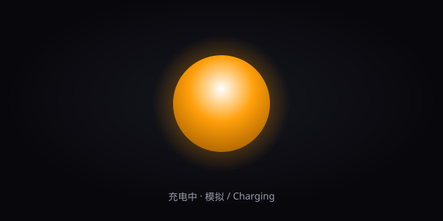

# Apple Battery LED · Customizable Charge Indicator

A zero-dependency, offline web recreation of Apple's iconic "breathing"
MagSafe charge indicator. Customize the colors, animation, glow and
brightness — or switch to **Live Battery** mode and let the LED follow your
real device's battery state.



> A visual tribute to Apple's battery charge LED. This is an independent
> re-creation and is not affiliated with Apple Inc.

## ✨ Features

- **4 light effects**: Breathing, Pulse, Ripple, Solid
- **3-state colors**: charging / full / low battery
- **Tunable**: size, speed, glow intensity, brightness
- **Live Battery**: reads `navigator.getBattery()` when available (Chrome / Edge)
- **5 presets**: Apple Classic, Midnight, Sunset, Neon, Matrix
- **Randomize** and **shareable links** (config encoded in the URL)
- **Device shell** toggle for a recessed-port look
- **Pure front-end**: no build step, no dependencies

## 🚀 Run

```bash
npm start                 # serves at http://localhost:8080
# or simply open index.html in a browser
```

## 🧩 Structure

```
apple-battery-led/
├── index.html
├── css/style.css
├── js/{state,led,battery,controls,main}.js
├── server.js
├── preview.svg
├── LICENSE
└── package.json
```

## 📄 License

[MIT](LICENSE) © 2026 Your Name
