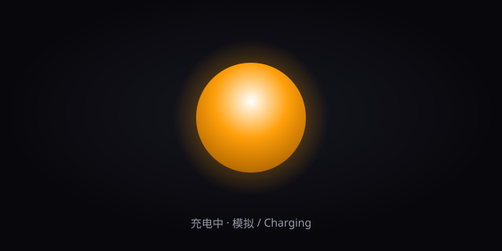

# Apple Battery LED · 可自定义充电指示灯

把苹果笔记本上那颗会「呼吸」的 MagSafe 充电指示灯，做成一个**零依赖、可离线运行**的网页灯效工具。你可以自由定制颜色、动画、光晕与亮度，也能切到「实时电量」模式，让指示灯跟随你真实设备的电池状态变化。



> 灵感来自 Apple 的电池充电指示灯，本项目为其视觉风格的再创作与可定制实现，与 Apple Inc. 无任何关联。

## ✨ 特性

- **四种灯效**：呼吸（Breathing）、脉冲（Pulse）、涟漪（Ripple）、常亮（Solid）
- **三态配色**：充电中 / 已充满 / 低电量，各自独立配色
- **可调参数**：尺寸、速度、光晕强度、整体亮度
- **实时电量**：开启「Live Battery」后读取 `navigator.getBattery()`，指示灯随真实设备充电状态变化（Chrome / Edge 支持）
- **5 套预设**：Apple 经典、Midnight、Sunset、Neon、Matrix
- **一键随机**：快速生成一套新配色与节奏
- **分享链接**：把当前灯效编码进 URL，复制即可分享
- **设备外壳**：开启凹面端口质感，更接近真实指示灯
- **纯前端**：无构建步骤、无第三方依赖，双击 `index.html` 即可运行

## 🚀 运行

方式一（推荐，零安装）：

```bash
# 直接用浏览器打开
open index.html        # macOS
# 或
python3 -m http.server 8080   # 然后访问 http://localhost:8080
```

方式二（使用内置 Node 静态服务器）：

```bash
npm start              # 启动后访问 http://localhost:8080
```

> 提示：由于浏览器对 `file://` 下 ES Module 的限制，本项目使用经典 `<script>` 引入，因此**双击 `index.html` 也能直接运行**，无需服务器。

## 🎛️ 自定义

所有参数都集中在 `js/state.js` 的 `BL.DEFAULT_CONFIG` 中，你可以在代码里改默认值，也可以通过界面实时调整：

| 参数 | 说明 |
| --- | --- |
| `chargingColor` | 充电中颜色（默认琥珀色 `#ff9f0a`） |
| `fullColor` | 充满颜色（默认绿色 `#34c759`） |
| `lowColor` | 低电量颜色（默认红色 `#ff3b30`） |
| `mode` | `breathing` / `pulse` / `ripple` / `solid` |
| `speed` | 动画速度倍率 |
| `glow` | 光晕强度 0–1 |
| `brightness` | 整体亮度 0.3–1.5 |
| `size` | 指示灯直径（px） |

想新增预设？在 `BL.presets` 里加一项即可，控制台会自动出现对应选项。

## 🧩 项目结构

```
apple-battery-led/
├── index.html        # 页面与控制台
├── css/style.css     # 样式与 LED 视觉
├── js/
│   ├── state.js      # 全局配置、预设、分享链接编解码
│   ├── led.js        # requestAnimationFrame 渲染引擎
│   ├── battery.js    # 实时电量接入（含降级提示）
│   ├── controls.js   # 控制台交互
│   └── main.js       # 启动入口
├── server.js         # 零依赖静态服务器（npm start）
├── preview.svg       # 预览图
├── LICENSE           # MIT
└── package.json
```

## 🤝 贡献

欢迎 PR 与 Issue！无论是新的灯效模式、配色预设，还是对移动端的适配改进，都很有价值。

1. Fork 本仓库
2. 创建特性分支 (`git checkout -b feat/your-idea`)
3. 提交改动 (`git commit -m 'feat: ...'`)
4. 推送到分支并发起 Pull Request

## 📄 许可证

[MIT](LICENSE) © 2026 Your Name
